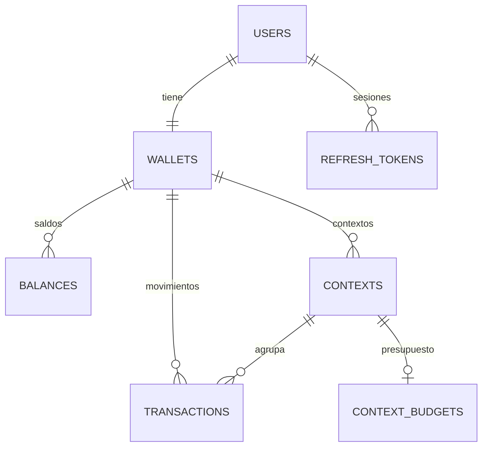

# Base de datos y migraciones

El esquema de PostgreSQL se versiona con [`node-pg-migrate`](https://salsita.github.io/node-pg-migrate/) usando **archivos SQL numerados** en `migrations/`. Cualquier persona del equipo reconstruye la base de datos con un solo comando.

## Aplicar migraciones

```bash
npm run migrate:up
```

Requiere `DATABASE_URL` en tu `.env`. La tabla `pgmigrations` registra cuáles ya se aplicaron, así que es seguro ejecutarlo varias veces. Requiere PostgreSQL 13 o superior (se usa `gen_random_uuid()`).

## Migraciones actuales

| # | Archivo | Qué crea |
|---|---------|----------|
| 001 | `create_users` | `users` |
| 002 | `create_wallets` | `wallets` (una por usuario) |
| 003 | `create_balances` | `balances` (saldo por moneda) |
| 004 | `create_contexts` | `contexts` |
| 005 | `create_transactions` | `transactions` |
| 006 | `create_context_budgets` | `context_budgets` |
| 007 | `create_exchange_rates_cache` | `exchange_rates_cache` |
| 008 | `create_refresh_tokens` | `refresh_tokens` |
| 009 | `add_last_activity_to_refresh_tokens` | Columna `last_activity_at` |

## Crear una migración nueva

El proyecto usa archivos con número consecutivo y sufijo `.up.sql`:

```
migrations/010_descripcion_corta.up.sql
```

1. Toma el **siguiente número libre**. Revisa `main` y los PR abiertos para no repetirlo con otra persona.
2. Escribe SQL con un comentario inicial que explique el cambio:

```sql
-- Migración 010: agrega la columna X a la tabla Y.
ALTER TABLE tabla ADD COLUMN columna TEXT;
```

3. Pruébala en una base local vacía: `npm run migrate:up`.

> Aún no se escriben migraciones "down". Si necesitas deshacer algo en desarrollo, recrea la base de datos y vuelve a aplicar todo.

## Reglas del equipo

1. **Una migración = un cambio lógico** (una tabla, una columna, un índice).
2. **Nunca edites una migración que ya está en `main`.** Si te equivocaste, crea una nueva que corrija.
3. Toda migración va en el **mismo PR** que el código que la necesita.
4. Prueba desde cero (base vacía) antes de abrir el PR.
5. Si dos personas crean el mismo número, la segunda renumera su archivo antes de integrar.
6. No pongas datos reales ni secretos en migraciones.

## Convenciones de nombres

| Elemento | Convención | Ejemplo |
|----------|-----------|---------|
| Tablas | `snake_case`, plural | `users`, `wallets`, `transactions` |
| Columnas | `snake_case` | `created_at`, `user_id` |
| Llave primaria | `id UUID` con `gen_random_uuid()` | `id UUID PRIMARY KEY DEFAULT gen_random_uuid()` |
| Llaves foráneas | `<tabla_singular>_id` | `wallet_id`, `user_id` |
| Fechas | `TIMESTAMPTZ` | `created_at TIMESTAMPTZ NOT NULL DEFAULT NOW()` |

## Buenas prácticas de modelado

- Declara `NOT NULL`, `UNIQUE`, `CHECK` y llaves foráneas en la base de datos, no solo en el código.
- **Dinero:** usa `DECIMAL`/`NUMERIC` (como ya hace `transactions`), nunca `FLOAT`. Guarda siempre la moneda en una columna aparte.
- Añade índices para columnas usadas en filtros o `JOIN` frecuentes.
- Contraseñas siempre con hash (`bcrypt`), nunca en texto plano.

## Diagrama (resumen de relaciones)



Las relaciones del diagrama salen de las migraciones 001 a 009. Si cambia el modelo, actualízalo en el mismo PR.
